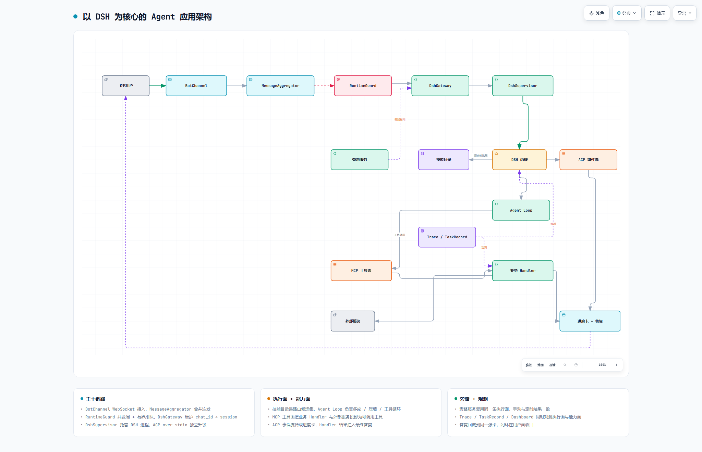
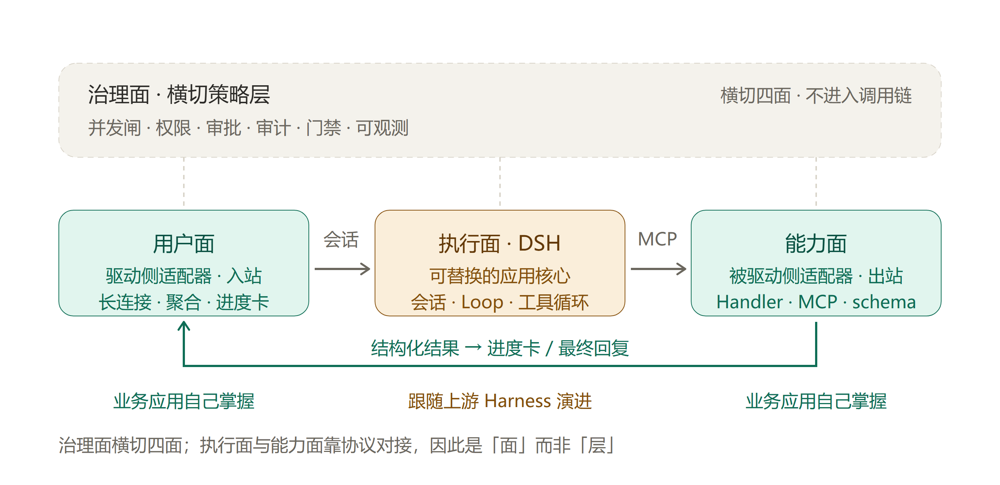
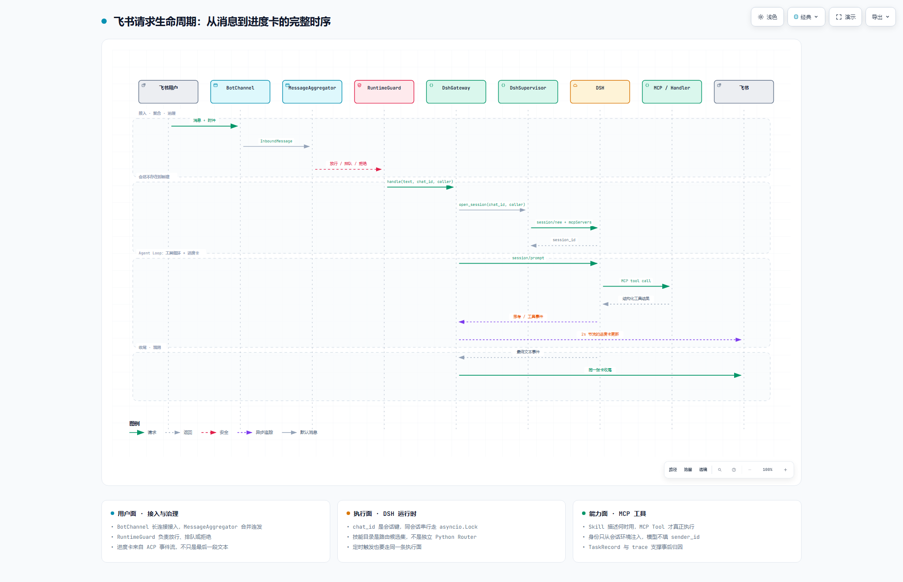
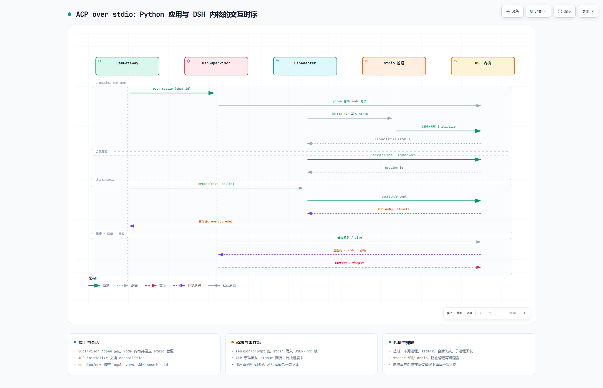
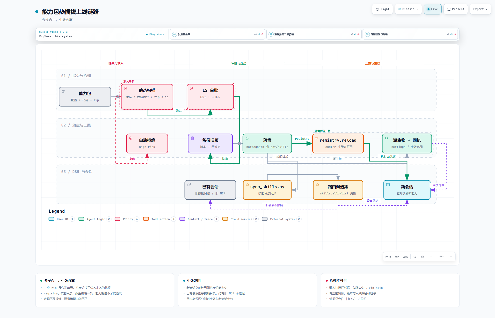

# feishu-agent-platform

> 一个**基于 DSH（DeepSeek Harness）的飞书应用**：DSH 当 Agent 运行时，飞书当交互层，
> 中间的治理与业务能力由应用自己掌握。

[English](#english) | 中文

---

## 它是什么

飞书群聊/私聊里的一个机器人。用户说一句话，它自己判断该用哪项能力、调哪些工具、
拿回什么数据，最后用一张卡片把过程和结果一起交回来。

和「用 Python 手写一个 agent」的区别在于：**会话、语义路由、Agent Loop、工具循环、
上下文压缩、子 Agent、技能发现**这些通用能力，全部由 DSH 内核提供，跟随上游演进；
应用只写「哪些能力存在、怎么执行、谁可以用」。

一句话概括分工：

```
Agent 应用 = Harness 能力 + 业务能力 + 渠道适配 + 治理闭环
                ↑ DSH          ↑ 你写       ↑ 你写        ↑ 你写
```



## 四个职责面

按「变化跟谁走」切分，而不是按「代码放在哪个目录」切分。

| 面 | 谁来干 | 在本仓的落点 | 变更频率 |
|---|---|---|---|
| **用户面**（驱动侧适配器） | 应用 | `app/gateway/`（飞书长连接、连发合并、进度卡） | 低 |
| **治理面**（横切策略） | 应用 | `app/guardrails/`、权限判定、审批与审计 | 低 |
| **执行面**（可替换内核） | **DSH** | `app/dsh/`（进程托管 + ACP 协议桥） | 跟随上游 |
| **能力面**（被驱动侧适配器） | 应用 | `app/mcp/`、`app/agents/handlers/`、`bot/skills/` | 高 |



切分的意义只有一条：**通用能力跟随上游 Harness 演进，治理与业务必须由应用自己掌握。**
边界守住，换内核只是换一次协议对接；守不住，每次升级都要重做一遍业务。

## 一次请求怎么走完全程

```
飞书 (WebSocket, app/main.py)
    │
BotChannel ── 长连接收消息，群里默认要求 @
    │
MessageAggregator ── 连发消息 debounce 合并（一句话被拆成 4 条也当一个请求）
    │
RuntimeGuard ── 全局并发闸 + 有界排队（超限回「系统繁忙」，不无限堆）
    │
DshGateway ── chat_id → dsh session（同会话串行、空闲 TTL、失效恢复）
    │
dsh 内核 (ACP over stdio)
    ├─ 语义路由：拿技能目录做候选集，判断这句话该用哪项能力
    ├─ Agent Loop：多轮推理 + 工具调用循环，上下文自动压缩
    └─ 会话常驻：同一 chat 粘同一 session，多轮历史不重复灌
    │
MCP 工具面（每会话一份子进程，身份在启动时经 env 固定）
    ├─ capabilities ── 进程内 Handler 的 tools 原样投影（能力的执行入口）
    ├─ feishu ──────── 发/回消息、读文档、读当前会话上下文
    └─ domains ─────── 业务域只读入口
    │
回复飞书（进度卡 → 原地刷成完成态，答案写在同一张卡里）
    └─ 同时落 TaskRecord / trace / 成本，供控制台 :9112 复盘
```



越过治理面之后，DSH 接手的不是「一条飞书消息」，而是**「一个已经建好的会话 + 一句明确的指令」**。

## 为什么是进程边界，而不是 import 内核

DSH 跑在 Node 进程里，应用是 Python。最省事的做法是进程内调用，但会同时踩三个坑：

| 坑 | 后果 |
|---|---|
| 崩溃连坐 | Agent Loop 里任何一环崩掉，带走整个 bot 进程，飞书长连接断，全部会话失联 |
| 演进焊死 | 内核一升级，应用要跟着重新构建部署，两类变化又缠回一处 |
| 只剩结尾 | 函数调用只拿回最终结果，思考/工具开始/工具完成没有出口，进度卡失去事件源 |

所以走 **ACP over stdio**（Agent Client Protocol，JSON-RPC over 标准输入输出）：

- `DshSupervisor` 管进程：启动、握手、健康探测、崩溃按指数退避重启、关停整树回收；
- `DshAdapter` 是全仓唯一触碰协议的地方：spawn、分帧收发、会话生命周期、事件翻译；
- 内核崩在自己的进程里，Supervisor 探测到再拉起，**bot 的长连接不受影响**；
- 两侧守住协议就能各自升级，不必同步发版；
- ACP 的事件流（思路、工具开始、工具完成、失败）直接成为**进度卡的数据源**。



顺带收益：stdio 子进程随父进程退出而关闭，管道断开本身就是死活信号，省掉端口与鉴权。
代价是引入了分布式系统的问题——协议超时、进程状态识别、stderr 必须单独 drain
（否则管道写满阻塞）、会话失效要重建、子进程要整树回收。这些都落在 `app/dsh/` 里。

## 身份与会话模型

**模型可以生成参数，但不能生成身份。** 这条是硬线。

会话身份不走工具参数——工具参数是可生成的内容，模型从对话里「听说」一个用户名就会填进去。
真实做法是在建会话时把身份写进 MCP 子进程的 env：

```
open_session(chat_id, caller)
    └─ env: PROMATE_CALLER_CHAT_ID / _SENDER_ID / _SENDER_NAME
         └─ dsh 给每个会话起独立的 MCP 进程 → 谁提问就是谁，不会串台
```

会话键是 `chat_id`：同一会话内串行（避免两个请求抢同一份上下文），空闲超 TTL 回收。
会话失效时重建一次，而不是把错误抛给用户。

## 扩展落在哪：五类落点

扩展性不是「代码里多几个 if」，而是把变化限制在稳定边界内。
判断标准只有一条：**你要改变的是模型的认知，还是系统的行为？**

| 扩展诉求 | 落点 | 产物 | 影响路由 |
|---|---|---|---|
| 新增业务能力 | Agent 元数据 + Skill | `bot/agents/*/agent.yaml`、`bot/skills/*/SKILL.md` | 是 |
| 新增可执行动作 | MCP Tool / Handler | `app/agents/handlers/*.py` | 间接 |
| 复用外部系统 | 独立 MCP Server | `config.toml [projects.mcp.<name>]` | 否，挂上即可用 |
| 改变运行时行为 | Cordis Plugin / DSH Profile | `deploy/dsh/agentbiz/cordis.patch.yml` | 否，改的是执行环境 |
| 复杂任务分工 | Subagent | 子会话、并行探索、隔离上下文 | 由主 Agent 调度 |

> **MCP 挂能力，Cordis 改环境。** 业务能力写成 Cordis 插件会改变整个 profile 的
> 运行时，影响面远大于一个工具，且难复用、难审计。

错落的落点有明确代价，不是风格问题：

- 业务能力写成 Python 脚本 → 绕开技能目录，用户说「帮我做 X」时模型不知道它存在；
- 工具实现塞进 Skill → 描述得再准也执行不了，只会得到一段文本；
- 外部系统直接 import 进 Handler → 对方崩溃连带业务进程一起挂。

## 配置与代码的分界

同一项能力有两份描述，被读取的时机根本不同：

| | `agent.yaml` + `SKILL.md` | Handler |
|---|---|---|
| 读取时机 | **路由期**（决定用不用） | **执行期**（决定怎么调） |
| 内容 | 身份、路由描述、权限级别、超时、通道 | 工具名、schema、实现 |
| 判断口诀 | 它在「决定用不用」时就要知道？ | 还是在「真正执行」时才用得上？ |

所以目录一眼就能看出哪份给模型读、哪份给运行时跑：

```
bot/          ← 全是身份与路由（模型读）
  agents/my-agent/agent.yaml
  prompts/agents/my-agent.md
  skills/my-skill/SKILL.md
app/          ← 全是执行（运行时跑）
  agents/handlers/my_agent_handler.py
  mcp/my_system_server.py        # 外部系统复用时才有
tests/        ← 契约与行为
```

**唯一容易放错的是 `tools`。** 它看起来像清单，实际属于执行：schema、参数、返回值、
错误都和 Handler 实现绑在一起，是代码的一部分（类属性），不是能独立声明的东西。
写进 yaml 就凭空多出一份真相——Handler 改了签名、yaml 没跟着改，模型照着旧 schema 调，
报的还是「本会话没有这个执行入口」。这类漂移静态检查查不出来。

## 定时与事件：触发归触发，执行归执行

两类定时必须分开，塞进同一个调度器就丢了差别：

| | 会话提醒 | 业务定时 |
|---|---|---|
| 回答的问题 | 这句话什么时候回到**原会话** | 到点产出**投给谁**、任务归谁管 |
| 目标 | 发起人当前会话 | 任意群 / 用户 |
| 需要 | 复用原会话上下文与身份 | 任务状态、审批、运行历史、群发 |

**反过来，执行面必须统一。** `ScheduledTaskExecutor` 把到期指令交给
`DshGateway.handle(...)` —— 和用户手动发同一句话走的是同一条 Agent Loop、同一套工具表、
同一份技能目录。所以定时产出与人工答复不会出现两套结果。

外部事件（监听类旁路）守的是同一条线：触发链可以不同，执行永远回到 DSH。

调度链的硬约束（都在 `app/ops/scheduler/` 里，有单测钉住）：

- 同一 `task_id + scheduled_at` 重试不重复发消息；
- 进程重启后 `approved/` 里的任务能接着排期；
- 停机 7 天醒来**只回放最近一次**过期时点，不是补发 7 条；
- 上一轮还没跑完，本轮触发跳过，不叠加；
- 投递回执 `success=false` 必须记为失败，不能当成功。

## 加一个能力

```bash
# 1) 声明身份（路由期元数据）
mkdir -p bot/agents/my-agent && $EDITOR bot/agents/my-agent/agent.yaml
# 或者只加一个纯 Skill 包
mkdir -p bot/skills/my-skill && $EDITOR bot/skills/my-skill/SKILL.md

# 2) 要执行逻辑就加 Handler（执行期实现，自动发现、零注册）
$EDITOR app/agents/handlers/my_agent_handler.py

# 3) 让 DSH 看得见：同步技能白名单（不进白名单 = 不在路由候选集）
python deploy/dsh/sync_skills.py --add my-skill

# 4) 重启
python -m app.main
```

一个能上线的能力至少交出四段，缺哪段都会以具体故障显形：

```
能力 = 路由描述（什么时候用）+ 执行工具（怎么调）+ 实现 + 治理（权限/副作用/审计）
```

> 只写 SKILL.md → 模型知道该怎么做却没有执行入口，只能空转；
> 只写 Handler → 模型不知道什么时候该调它；
> 缺治理 → 写操作没人审批，出事查不到审计。

`agent.yaml` 就是这样一份纯声明，没有一行可执行代码：

```yaml
name: my-agent
display_name: "我的业务助手"
description: "当用户要查询、比对或处理某某业务时使用；只读，不修改生产数据"
permission_level: 1
transport: handler
exclusive_domain: true
timeout_sec: 60
prompt_ref: "agents/my-agent.md"
mcp_servers: {}
```

管理员不想走重启这条路径时，能力包可以直接发进飞书会话热插拔生效：



## 快速开始

```bash
python -m venv .venv && . .venv/Scripts/activate      # Windows / macOS: source .venv/bin/activate
pip install -r requirements.txt
pnpm install                                          # DSH 运行时钉在仓内 node_modules，不依赖全局安装

cp .env.example .env                                  # 填飞书与模型凭据
python -m app.main                                    # 飞书长连接 + 控制台 :9112
```

飞书侧：自建应用（`FEISHU_APP_ID` / `FEISHU_APP_SECRET`）、开启长连接与机器人能力、
`im:message` 收发与 `docx` 读权限。逐步骤见 `docs/feishu-platform-setup.md`。

DSH 侧：内核版本钉在 `package.json`（`@deepseek-ai/dsh`），profile 在
`deploy/dsh/agentbiz/`（模型 Provider、系统提示词、技能根、沙箱插件都在这里组装）。
独立 `DSH_HOME`（`../.dsh-bot`）保证与桌面版 dsh 不共享凭据与会话。

## 门禁

```bash
python -m pytest -q --basetemp=temp/pytest-tmp        # 230 passed
python -m ruff check app/ --select F821,F811,F401,F541,F841
python -X utf8 -m mypy <改动文件>
python -X utf8 -m app.eval.comment_lint <改动文件>      # 注释纪律：禁变更日志式注释
python app/eval/prompt_eval.py                        # 提示词 golden 回归
python deploy/dsh/verify_routing.py                   # 真实会话的路由回归
```

没有路由基线、契约测试和回滚路径，建出来的只是能跑的 Demo，不是能运营的应用——
能力越加越多，却没有办法证明新加的那个没有抢走旧的路由。

## 仓库骨架

| 层 | 路径 | 职责 |
|---|---|---|
| gateway | `app/gateway/` | 飞书接入、连发合并、控制台 HTTP |
| dsh | `app/dsh/` | 进程托管、ACP 协议、chat→session、事件→卡片 |
| mcp | `app/mcp/` | 会话工具面：feishu / domains / capabilities |
| agents | `app/agents/` | Agent 注册表 + Handler 约定式自动发现 |
| ops | `app/ops/` | 能力热插拔、定时任务、健康探针 |
| guardrails | `app/guardrails/` | 并发闸、命令拦截、审计 |
| observability | `app/observability/` | 任务档案、trace、成本、巡检报表 |
| domains | `app/domains/` | 业务域示例：日报 / 技能目录 |
| 单源 | `bot/agents/` `bot/prompts/` `bot/skills/` | 身份、提示词、能力包 |
| 运行时 | `deploy/dsh/agentbiz/` | DSH profile：Provider / 提示词注入 / 技能根 / 白名单 |

本仓是**脱敏后的骨架**：只保留三个示例能力，用来验证「声明 → 同步 → 路由 → 执行 → 交付」
整条链路跑得通。

| 能力 | 通道 | 做什么 |
|---|---|---|
| `aihot` | skill | AI 资讯 / 日报（卡片出口，文本兜底） |
| `schedule-agent` | handler | 定时/周期任务：评估通过即生效 |
| `digital-oracle-agent` | handler | 市场数据驱动的概率预测 |
| `skill-catalog-agent` | handler | 团队 Skill 目录检索与治理 |
| `dev-bot` | cc-connect | 桥接本地 Claude Code 的开发通道（`/dev` 直达） |

## 常见反模式

| 反模式 | 后果 | 正确做法 |
|---|---|---|
| 把个人全局 Skill 带进生产 | 近义能力抢路由，行为不可控 | `includeDefaultRoots: false` + 显式白名单 |
| 用 Python 再写一份能力清单 | 与技能目录漂移 | 以 `agent.yaml` / allowlist / registry 为单源 |
| 让模型填写 `sender_id` | 越权、错绑、审计失真 | 从受信会话环境注入 |
| 所有错误都自动重试 | 重复发消息、重复写库 | 只重试明确可重试且幂等的动作 |
| 定时任务另建执行通道 | 手动与定时结果不一致 | 定时任务调用同一个 `DshGateway` |
| Skill 里塞工具实现 | 技能目录变路由噪音 | Skill 描述能力，MCP Tool 执行 |
| 业务能力写成 Cordis 插件 | 影响整个 Profile，难复用 | 业务放 MCP / Handler |
| 只做提示词安全约束 | 实测会漏 | 权限与写操作下沉到工具层硬拒绝 |

## 文档地图

- `docs/project-index.md` — 功能级索引，改功能先查这里
- `docs/features/` — 每项能力的不变量、边界与踩坑证据
- `docs/adr/` — 架构决策记录（含 DSH 迁移）
- `docs/diagrams/` — 运行时架构图、请求生命周期图（源是 `.archify.json`）
- `docs/images/` — README 里引用的成图（`four-planes` / `dsh-architecture` / `request-lifecycle` / `acp-stdio-sequence` / `capability-hotplug`）
- `CLAUDE.md` — 给 AI 编码助手的项目约定

## English

A **Feishu (Lark) AI Agent application built on DSH (DeepSeek Harness)**. DSH is the
agent runtime — sessions, semantic routing, agent loop, tool-calling, context
compaction, sub-agents and skill discovery all come from it. The application owns four
things: **channel adaptation, governance, business capabilities, and observability.**

Design split by *what changes with what*:

| Plane | Owner | Why |
|---|---|---|
| User plane (driving adapter) | app | Feishu long connection, message merging, progress cards |
| Governance plane | app | concurrency gate, permissions, audit — never outsource |
| Execution plane | **DSH** | replaceable kernel, upgraded independently |
| Capability plane | app | MCP tools + handlers; highest change frequency |

The kernel runs as a **separate Node process spoken to over ACP (JSON-RPC on stdio)**,
not imported in-process. That buys three things: a kernel crash can't take down the
bot's WebSocket; both sides upgrade on their own schedule; and the session event stream
becomes the data source for live progress cards.

Other invariants worth knowing:

- **The model may generate parameters, never identity.** Caller identity is written into
  each session's MCP subprocess env at startup, so "who asked" cannot be spoofed from
  conversation text.
- **One execution plane, many triggers.** Scheduled jobs, external watchers and manual
  questions all funnel into the same `DshGateway` → same tools, same skill catalog, same
  model behaviour.
- **`agent.yaml` is identity, Handler is execution.** Routing-time metadata is read from
  config only; tool schemas live in code (class attributes). Duplicating them in yaml
  guarantees drift.
- **MCP mounts capabilities, Cordis changes the environment.** Business code never ships
  as a runtime plugin.

Credentials live only in `.env`. Every hosted/proprietary identifier in this repo is a
placeholder (`example.com`, `ou_admin000…`); substitute your own before running.

## 许可

MIT
